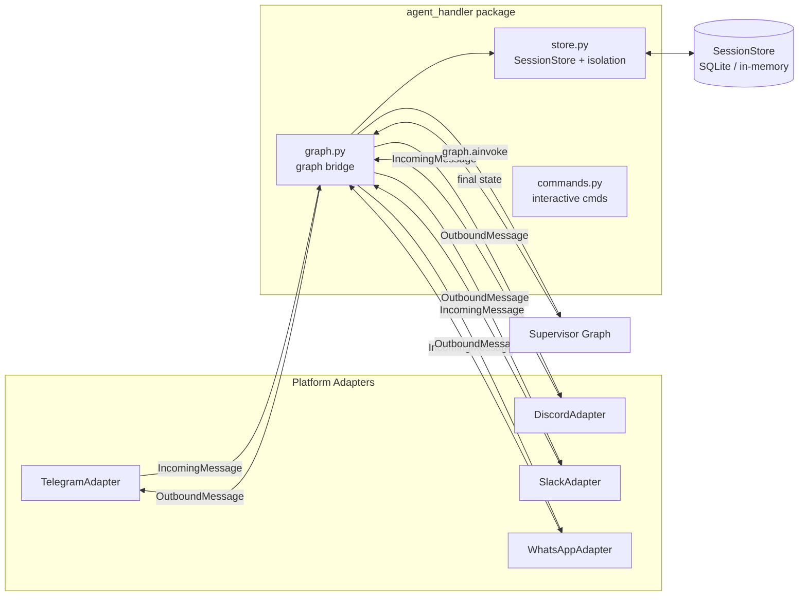

> This page is published at [kazma.ai/docs/gateways-and-platforms/](https://kazma.ai/docs/gateways-and-platforms/) ([Arabic](https://kazma.ai/ar/docs/gateways-and-platforms/)).

> How Kazma's one brain talks to many channels: the adapter layer, platform isolation, the session store, slash commands, and a feature-parity matrix — all verified against `kazma-gateway/`.

---

## 1. Architecture

Kazma's gateway package (`kazma-gateway/kazma_gateway/`) was refactored from a single `agent_handler.py` into an **`agent_handler/` package** (decomposition noted in `agent_handler/__init__.py:4`). The shape is:



- **Adapters** (`adapters/`) — one per platform; all extend `BaseAdapter` (`gateway.py:239`). Each translates platform-native events into Kazma's `IncomingMessage` and renders `OutboundMessage` back.
- **agent_handler package** — the bridge between adapters and the supervisor graph.
- **Bus adapters** (`adapters/*_bus.py`) — a *separate* set of adapters for swarm HITL approvals (Telegram/Discord/Slack). See [Security & Safety](security-and-safety#the-swarm-bus-gate).

---

## 2. Platform adapters

### 2.1 Telegram (`adapters/telegram.py`)

| Aspect | Detail |
|---|---|
| Class | `TelegramAdapter` (`telegram.py:70`), `name = "telegram"`. |
| Receive | Manual `getUpdates` **long-polling** (HTTP), 1-3 s jitter; optional webhook router `telegram_webhook_router()` mounted at `/api/webhooks/telegram`, which resolves the running adapter on every request. |
| Send | `POST /sendMessage` with HTML `parse_mode`, 429 retry, message chunking. |
| Context keys | `chat_id` (int), `user_id` (int), `username` (str), `message_id` (int), `chat_type` (str). |
| Extras | Voice/STT (`telegram_stt.py`), inline keyboards (`telegram_keyboards.py`), reactions (✅/🎯/❌), typing indicator, registered command menu via `setMyCommands`, inbound photo/document/video/animation capture, outbound `sendPhoto`/`sendDocument`/`sendVideo`/`sendAudio`. |
| Helper modules | `telegram_callbacks.py`, `telegram_keyboards.py`, `telegram_parse.py`, `telegram_send.py`, `telegram_stt.py`. |

Telegram is the **most feature-complete** adapter.

### 2.2 Discord (`adapters/discord.py`)

| Aspect | Detail |
|---|---|
| Class | `DiscordAdapter` (`discord.py:50`), `name = "discord"`. |
| Receive | Discord **Gateway WebSocket** (`wss://gateway.discord.gg/?v=10&encoding=json`). |
| Send | REST `POST /channels/\{channel_id\}/messages`, 429 retry, 2000-char chunking. |
| Context keys | `channel_id`, `guild_id`, `user_id`, `message_id`, `username`, `guild_name`. |
| Markdown | Plain text (Discord's own markdown is not generated). |

> **Slash commands:** Discord reserves `/`-prefixed commands for its own interaction system. Kazma receives them as plain text and parses internally.

### 2.3 Slack (`adapters/slack.py`)

| Aspect | Detail |
|---|---|
| Class | `SlackAdapter` (`slack.py:47`). |
| Receive | **Socket Mode** (when `xapp-` app_token present) OR fallback polling of `conversations.history`. |
| Send | REST Slack API `POST`. |
| Context keys | `channel_id`, `user_id`, `team_id`, `thread_ts`, `message_ts`, `username`. |

> **Slash commands:** Slack blocks bot-issued slash commands, so the HITL approval prompt is issued as `hitl approve|deny &lt;id>` **without** the `/` prefix (`graph.py:184`).

**Documents:** all platforms that reach the agent handler support `/documents` (alias `/docs`) for list/status/read/convert/pdf-info/redact/search/health against the shared Document Intelligence service. Every chat acts as the install's operator, as the Web **Documents** page and the agent's document tools do, so a document uploaded on the page is listed and read here and the reverse (since 2026-10-13; chat used an `agent` principal that saw none of the page's documents). With platform users (multi-user mode) the commands refuse: which user a chat message is has not been built. An id another tenant holds answers exactly like an unknown one. Chat attachments may auto-parse document types into fenced excerpts: a transient read in the isolated worker that stores nothing in the platform, creates no `document_id` and never goes to a remote parser. See [Slash commands — Documents](../reference/slash-commands.md#documents) and [Document Intelligence](./document-intelligence.md).

**Tables:** an answer's markdown tables are rewritten as lines before they go to Telegram, Discord or Slack (`kazma_gateway/chat_tables.py`), so they read on a phone. Code blocks are left as they are.

### 2.4 Every message accounted for, and a Test that diagnoses {#connector-test}

Each adapter keeps a record of what its connection received (`kazma_gateway/receive_log.py`): the connection's state and its last problem, and what became of each message — handed to Kazma, or left with a reason (the sender is not an allowed user, the message came from a bot, it carried nothing Kazma can read, the queue was full). A message left for a reason you can fix, such as an empty allowed-users list, is a WARNING in the log, at most every ten minutes per reason; a bot's message is logged at DEBUG, the rest at INFO.

**Settings → Providers & Connectors → Platform Connectors → Test** asks the platform and joins its answer with that record:

| Platform | What the Test checks |
|---|---|
| Telegram | The bot token; a webhook that would stop polling, and updates waiting; group privacy; the delivery chat (did the person press Start, did they block the bot); the group route; the last message a person sent and what became of it; allowed users; the connection |
| Discord | The bot token; the Message Content intent; the servers the bot is in; the delivery channel; the newest message a person wrote there; each allowed user's direct messages to the bot, with a link that opens the conversation; allowed users; the connection |
| Slack | The bot token; the app-level token (Socket Mode); the permissions the token carries; the delivery channel and whether the bot is in it; the newest message there and in each allowed user's direct messages, with a link; allowed users; the connection |
| WhatsApp | The access token and the phone number (Meta's answer); the app secret; the webhook address and whether Meta has called it; the last message a person sent and what became of it; the 24-hour window; allowed numbers; the connection ([2.7](#whatsapp)) |

The Test writes nothing, except that on Discord and Slack it opens the direct-message channel with each allowed user, which sends no message. The card saves its fields before it tests, and the Test checks the connection made with what was saved: if the running adapter was built from other settings, it is rebuilt first, and the Test waits up to ten seconds for the new connection's first attempt.

**Slack's Socket Mode connection.** Slack asks for a new connection from time to time: `refresh_requested` every few hours, `warning` about ten seconds before a server goes away, and `link_disabled` when Socket Mode is switched off in the app's settings or the app-level token the connection used is revoked. Kazma logs each request with its reason and Slack's server, and reconnects at once. `link_disabled` is a WARNING, and the Test shows it with the fix. When the connection opens, Slack says how many connections the app has open. It hands each event to only one of them, so a second program connected to the same Slack app (a second Kazma, an old test bot) quietly takes some of Kazma's messages. The count also includes a connection that ended without closing, until Slack notices, which can take hours. So more than one is not proof of a second program. When Slack counts more than one, the log gets a WARNING naming both, and the Test's connection check says which it is from the messages it checks. If one of them never reached Kazma, another program is taking messages; if they all reached Kazma, the count is stale. A count taken within 15 seconds of Kazma's own reconnect may still include Kazma's previous connection, so it counts only when it shows a connection besides those two. Slack allows an app ten connections at once and refuses one more with `too_many_websockets`; Kazma is not connected until a slot frees. It retries every few seconds. The first refusal of a run is a WARNING and the Test's problem, and the connection that follows logs how many refusals came first.

**Messages one person sends too fast.** Past `gateway.rate_limits` (30 messages a minute per person on each platform), Kazma answers "Slow down", at most every 30 seconds, and leaves the rest unanswered. Each message it leaves is recorded as `rate_limited` in the platform's record, so the log and the Test say what became of it. Until 2026-10-01 such messages left no trace, and Slack's limit was 1 a minute.

### 2.5 A saved setting reaches the running adapter {#saved-settings-apply}

A chat app's settings take effect when they are saved, wherever they are saved: the Platform Adapters card, a settings restore, the terminal app, or the agent. Within a second Kazma:

- rebuilds that platform's adapter when its token, app-level token (Slack), webhook secret (Telegram) or on/off switch changed, and leaves the other platforms connected;
- applies a changed allowlist, or a changed owner's chat (below), to the running adapter in place;
- rebuilds a platform's swarm sender when its bot token, switch or destination channel changed. An unchanged sender is kept, with the approvals it is waiting for.

A platform switched off in Settings stays off at boot and on every rebuild. **Refresh Gateway** (and `kazma gateway refresh`) rebuilds every adapter through the same code as boot, for when you want everything to reconnect. Until 2026-10-01 a saved token reached no running adapter until a Refresh. That Refresh used its own copy of the boot code, which started a platform switched off, dropped Telegram's webhook secret, and left adapters with no allowlist taking no messages. The code is `kazma_gateway/chat_adapters.py`, and the settings store tells it about every write.

### 2.6 Who a chat app answers {#who-it-answers}

Each platform's **Allowed User IDs** (Settings → Adapters & Routes) decides who may talk to Kazma through its bot. With the list set, only the users on it. With the list empty, the bot is **private** (since 2026-11-11): it answers only its owner's own account that Kazma already knows, and refuses everyone else. Kazma knows the owner's account from:

- on Telegram, a private chat Kazma already uses to reach you: the guard's alert chat (`guard.telegram.chat_id`, Settings → Alerts) or the delivery chat (`connectors.telegram.swarm_chat_id`). A group or channel id is never taken as a person;
- on any platform, a `platform:id` entry of `KAZMA_GATEWAY_ADMINS` (for example `discord:123456789012345678` or `slack:U0123ABCD`).

Discord and Slack keep no owner's user id anywhere else, so with an empty list and no admin entry they answer no one until you add yourself. The owner's account Kazma knows is also an admin there (approvals, `/config`), as a listed user is.

A refused sender writing to the bot in a direct message is told, at most once a day, that the bot is private, what their user id is, and where the owner adds it, in the language they wrote in. In a group, a server channel or a Slack channel the refusal is silent. A native `/kazma` command answers the same words privately (only the person who ran it sees them). Every refusal is recorded and logged with its reason, as in [2.4](#connector-test).

At each boot an adapter with an empty list logs one WARNING saying whom it answers and how to fix it, and its **Test** shows the empty list as a problem with the fix. To find your id, message the bot: the private notice names it.

`KAZMA_GATEWAY_OPEN_TO_EVERYONE=1` brings back the posture before 2026-11-11: a bot with an empty list answers anyone who can reach it. It is warned at every boot while it is on. `KAZMA_GATEWAY_STRICT_ALLOWLIST`, the old way to ask for what is now the default, changes nothing on its own and wins over the open switch when both are set. The rule is `kazma_gateway/sender_rule.py`; every adapter asks it.

### 2.7 WhatsApp (`adapters/whatsapp.py`) {#whatsapp}

Kazma talks on WhatsApp through Meta's **WhatsApp Cloud API**, with a business phone number of yours (Meta's test number works for trying it).

| Aspect | Detail |
|---|---|
| Class | `WhatsAppAdapter`, `name = "whatsapp"`. |
| Receive | A **webhook**: Meta sends every message to `/api/webhooks/whatsapp` on Kazma's public address (`KAZMA_PUBLIC_URL`). There is no polling, so Kazma must be reachable from the internet, for example through a Cloudflare Tunnel. |
| Who is calling | Meta signs every call with the Meta app's secret (`X-Hub-Signature-256`). Kazma checks the signature before it reads anything and answers 401 to a call without it. With no app secret saved it answers no call at all. |
| Send | Graph API `POST /<phone number id>/messages`, with the access token in a header, never in an address. Answers are converted to WhatsApp's own marks (`*bold*`, `_italic_`, code kept as written) and split at 4,096 characters. Links get no preview. |
| Reads | Text, photos, documents (downloaded and handed on as files), voice notes (transcribed by the same speech-to-text as the other chat apps), and Kazma's own buttons. A sticker, location, contact or reaction is recorded and not answered. |
| Approvals | Reply buttons: **Approve**, **Deny** and **Approve for task**. A question with more than three choices is a list. A public action (an X post) names itself on its button and has no task approval, as on every chat app. |
| Context keys | `chat_id` (the person's WhatsApp id: their phone number in digits), `user_id`, `username`, `message_id`, `chat_type` (`private`). |

**Allowed numbers.** WhatsApp's allowlist is a list of phone numbers with their country code, in any spelling (`+965 9999 1234`, `96599991234`). It follows the same rule as every chat app ([2.6](#who-it-answers)): with the list empty the number is private. A `KAZMA_GATEWAY_ADMINS` entry `whatsapp:+96599991234` makes that number the owner's.

**The 24-hour window.** WhatsApp lets a business write to a person only within 24 hours of that person's last message; after that only templates Meta has approved can be sent. Kazma answers inside the window. A reminder or alert due later reaches your other chat apps, not WhatsApp, and WhatsApp has no swarm sender for the same reason. A send outside the window fails with Meta's error 131047, which the log and the chat outbox name.

**Setting it up.** In Meta's developer site (developers.facebook.com):

1. Create an app of the **Business** type and add the **WhatsApp** product. Meta gives you a test number, or you add your own.
2. Under **WhatsApp → API Setup**, copy the **Phone number ID** (not the phone number itself) and an access token. The temporary token lasts 24 hours; for one that lasts, make a **system user** in Meta Business settings, give it the app and your WhatsApp account, and generate its token with the `whatsapp_business_messaging` permission.
3. With Meta's test number, add your own phone under **To** as a recipient: the test number writes only to numbers listed there.
4. Under **App settings → Basic**, copy the **App secret**.
5. In Kazma, **Settings → Providers & Connectors → Platform Connectors → WhatsApp**: paste the access token, the Phone number ID and the app secret; press **Make one** for a webhook verify token (it is copied for the next step); put your number in **Allowed numbers**; **Save**. The card shows the webhook address to give Meta.
6. Back in Meta, **WhatsApp → Configuration → Webhook → Edit**: the callback URL is the address the card shows, the verify token is the one you made. **Verify and save**, then subscribe the **messages** field.
7. Send the number a WhatsApp message from your phone, then press **Test** on the card.

**The Test** asks Meta about the number and joins its answer with what the webhook received: the access token and number, the app secret, the webhook (the address and whether Meta has called it since Kazma started), the last message a person sent and what became of it, the 24-hour window, the allowed numbers and the connection. The code is `kazma_gateway/adapters/whatsapp.py`, `whatsapp_api.py`, `whatsapp_parse.py`, `whatsapp_format.py` and `whatsapp_diagnose.py`.

---

## 3. Platform isolation (the core invariant)

This is the single most important contract in the gateway. **The LangGraph state must never contain `chat_id`, `user_id`, or `message_id`.** Breaking it leaks platform IDs into the graph and corrupts sessions.

### 3.1 The forbidden keys

`_PLATFORM_KEYS` (`agent_handler/store.py:16-31`) is the authoritative frozen set:

```python
_PLATFORM_KEYS = frozenset({
    # Telegram
    "chat_id", "user_id", "message_id", "update_id", "chat_type",
    # Discord / Slack
    "channel_id", "guild_id", "team_id", "thread_ts", "message_ts",
})
```

### 3.2 How isolation is enforced

`_build_initial_state(msg, store)` (`store.py:95`):

1. Resolves a `thread_id` via `_resolve_thread` (`store.py:34`):
   - existing `thread_id` in context_metadata, else
   - deterministic from sender id (e.g. `"telegram:12345"` → `"gw-telegram-12345"`), else
   - fresh `UUID4`.
2. Persists **full** platform context to the SessionStore: `await store.put(thread_id, dict(ctx))`.
3. Builds a **minimal** graph state with only a `_gateway` block:

```python
state["_gateway"] = {
    "thread_id": thread_id,
    "display_name": ctx.get("username") or "unknown",
    "platform": msg.platform,
}
```

4. A defense-in-depth pass strips any leaked `_PLATFORM_KEYS` (`store.py:139-141`).

### 3.3 How replies route back

After `graph.ainvoke()` completes (`agent_handler/graph.py:316`), the handler does `ctx = await _store.get(thread_id)` to **rehydrate** platform IDs, then routes via `_build_target_id(platform, ctx)` (`store.py:146`):

- Telegram → `chat_id`
- Discord/Slack → `channel_id`
- Produces platform-prefixed IDs like `"telegram:12345"`.

> **Persistence by design:** Session entries are **not** deleted after a reply (`graph.py:312-315`) so crash-recovery routing can rehydrate context. Stale entries are evicted lazily by a 300-second TTL (`graph.py:98`, `_session_ttl_seconds`).

---

## 4. SessionStore

The SessionStore holds platform IDs ↔ thread_id mappings — **never** the graph.

| Implementation | Location | Use |
|---|---|---|
| `SessionStore` (abstract) | `gateway.py:185` | `get`, `put`, `delete`, optional `evict_older_than`. |
| `_InMemoryStore` | `agent_handler/store.py:63` | Testing/fallback; tracks monotonic timestamps for TTL. |
| SQLite `SessionStore` | `stores/sqlite.py` | Persistent. |
| LangGraph checkpointer | `stores/checkpoint.py` | Used by the UI for conversation state (`app.py:724`). |

The `IncomingMessage` docstring (`gateway.py:62-66`) states it plainly: *"The Brain never touches platform-specific fields. Raw platform IDs live inside context_metadata."*

---

## 5. Web UI transport (SSE)

The Web UI uses **Server-Sent Events** as the graph transport.

- **Endpoint:** `POST /api/chat/stream` (`sse_chat/`) — accepts `{message, session_id, model}`, returns a `StreamingResponse` (`text/event-stream`).
- **Telemetry WebSocket:** `/ws/chat/{session_id}` is the Turn Delivery V2 cursor / live-frame bus. It does **not** run the graph and takes no turn control.
- **Client wiring:** `chat.js` always calls `KS.sse('/api/chat/stream', …)` for turns and `POST /api/approve/{thread_id}` for HITL.

The full SSE event contract (`token`, `tool_call`, `tool_result`, `approval_required`, `done`, `error`) is documented in [API & Extension Points](api-and-extension-points#sse-event-contract).

---

## 6. HITL approval surface per platform

| Platform | Mechanism | Callback id pattern | Handler |
|---|---|---|---|
| **Telegram** | Inline keyboard buttons | `hitl:approve:\{id\}` / `hitl:deny:\{id\}` | `telegram.py:733` |
| **Discord** | Components v2 buttons | `swarm_approve_\{task_id\}` / `swarm_reject_\{task_id\}` | `discord.py:312` |
| **Slack** | Interactive callback | swarm approval block | `slack.py:401` |
| **WhatsApp** | Reply buttons (a list past three) | `hitl:approve:\{id\}` / `hitl:deny:\{id\}` / `hitl:approve_task:\{id\}` | `adapters/whatsapp.py` |
| **Web UI** | Button → `POST /api/approve/\{thread_id\}` + `approval_required` SSE event | — | `routes_direct/misc.py` |

The Discord and Slack rows are the swarm bus's approvals. Chat approval cards
use the same `hitl:approve:<id>` / `hitl:deny:<id>` / `hitl:approve_task:<id>`
actions on all three platforms. An X card names its action and has no
"Approve for task". An expired card is announced in the chat, and the turn is
delivered there.

> The **bus adapter singleton** priority is Telegram > Discord > Slack (only one active at a time, wired in `app.py:506-556`). See [Security & Safety](security-and-safety#bus-adapter-priority).

---

## 7. Feature parity matrix

| Feature | Telegram | Discord | Slack | WhatsApp | Web UI | TUI |
|---|:---:|:---:|:---:|:---:|:---:|:---:|
| Receive mechanism | HTTP long-poll | Gateway WS | Socket Mode / poll | Meta webhook | HTTP POST (SSE) | local |
| HITL approval buttons | ✅ | ✅ | ✅ | ✅ reply buttons | ✅ | modal |
| Markdown rendering | → Telegram HTML | plain text | plain text | → WhatsApp marks | client-side | plain |
| Slash commands | full set (registered) | plain-text parse | `hitl` w/o `/` | plain-text parse | UI buttons | — |
| Voice / STT (inbound transcribe) | ✅ | ✅ | ✅ | ✅ | ✅ `/api/voice/stt` | — |
| Voice / TTS (outbound reply) | ✅ | ✅ | ✅ | ❌ | ✅ `/api/voice/tts` | — |
| Media in/out (photo/doc/video) | ✅ | ✅ | ✅ | photo/doc in, files out | ✅ `/api/chat/upload` | — |
| Typing indicator | ✅ | ✅ | ✅ | ❌ (read ticks) | n/a | n/a |
| Reactions | ✅ ✅/🎯/❌ | ❌ | ❌ | ❌ | n/a | n/a |
| Model selector UI | ✅ inline keyboard | ❌ | ❌ | ❌ | ✅ settings | read-only |

---

## 8. The Textual TUI (`kazma-tui`)

A read-mostly observability dashboard over the same core singletons.

| Aspect | Detail |
|---|---|
| Entry point | `kazma_tui.app:main` → `KazmaTUI().run()`. |
| Tabs | Dashboard (`MetricsDashboard`), Memory (`MemoryTab`), Chat (`ChatPanel`), Files (`FilesPanel`), Traces (`TracesPanel`), Swarm (`SwarmPanel`), Settings (`SettingsPanel`), Documents (`DocumentsPanel`). |
| Singleton init | `_initialize_core()` initializes `ModelRegistry` and `SwarmEngine` if launched standalone. |
| HITL | Approval modal (`widgets/hitl_modal.py`); `_check_pending_approvals`, `_submit_hitl_decision`. |
| RTL | `update_localization()` toggles an `rtl-mode` CSS class and translates the tab labels, in the web UI's words (`TAB_LABELS`). |

---

## 9. Telegram command registration

`_register_bot_commands` (`telegram.py:961`) calls Telegram's `setMyCommands` across three scopes (default, all_private_chats, all_group_chats). The registered list includes the standard slash commands **plus `/swarm`**. It does **not** register `/hitl` (because Slack needs the bare `hitl` form, and the registration is shared logic).

---

## Documentation Audit Notes

- **`agent_handler.py` no longer exists** as a single file — it is the `agent_handler/` package. Older docs referencing the file are stale.
- **Graph transport is SSE.** `/ws/chat/{session_id}` is live as a telemetry / cursor bus; it does not run the graph.
