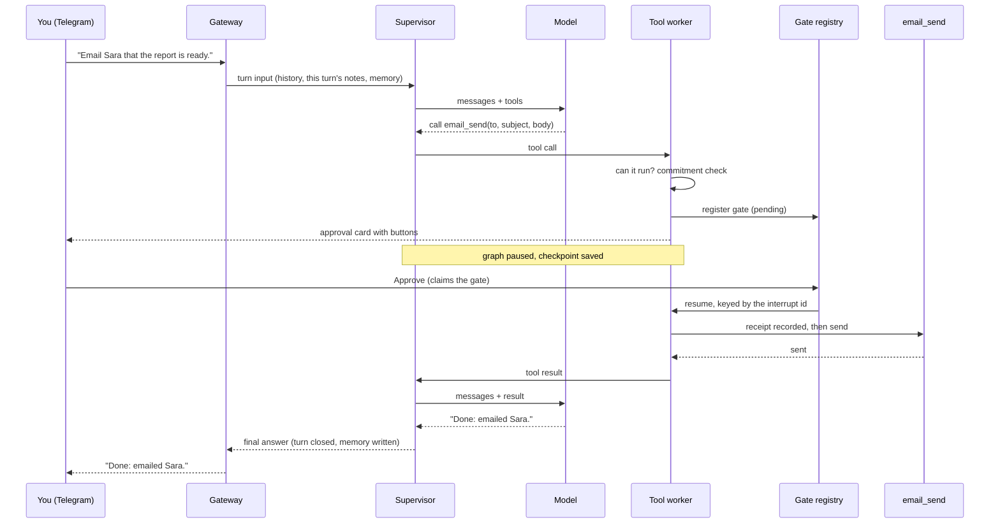

# How a turn works

> This page is published at [kazma.ai/docs/how-a-turn-works/](https://kazma.ai/docs/how-a-turn-works/) ([Arabic](https://kazma.ai/ar/docs/how-a-turn-works/)).

A *turn* is everything Kazma does between a message and its answer. This page
follows one message through the whole system:

> Email Sara that the report is ready.

It arrives on Telegram, needs a tool that sends something outside Kazma, and
so stops for your approval. That makes it a good tour. Each step says what
happens, why it is built that way, and where the code is. For the mechanisms
themselves, see [Engineering inside Kazma](engineering.md). For the map of
components, see [Architecture](architecture.md).

## 1. The message arrives

The Telegram adapter receives the message and records what happens to it:
handed on, or dropped with a reason (not on the allowed-user list, a bot, the
flood guard of 30 messages a minute). Every message ends up in one of those
two states, so Settings' Test can tell you what became of the last one.

The gateway keeps Telegram's chat id and message id in its own session store.
They never enter the agent's state. The graph sees a thread id and a platform
name, and the reply address is restored only when the answer is sent. This
keeps platform details out of saved conversations, and stops one chat's
address from leaking into another's turn. One lock per thread keeps two
messages from the same chat from running over each other.

**Where:** `kazma_gateway/adapters/telegram.py`, `kazma_gateway/receive_log.py`,
`kazma_gateway/agent_handler/graph.py` (`_handler_body`),
`kazma_gateway/agent_handler/store.py` (`_build_target_id`).

## 2. The turn is assembled

The conversation so far comes from the LangGraph checkpoint. Before it is sent
anywhere, the notes that belonged to the *previous* turn are removed: its
environment block, its memory block, its "latest message" pin. Then this
turn's own notes are added. Without that step, a chat's fourth turn once sent
the model sixteen system notes, including the workspace the user had already
switched away from.

The turn also records the workspace it starts in. If it later pauses for
approval, it resumes in that same folder even if someone switches repositories
in between. An optional time limit (Settings → System) bounds each running part
of the turn. Time spent waiting for you is not counted.

**Where:** `kazma_core/agent/turn_input.py` (`build_turn_messages`),
`kazma_core/turn_notes.py`, `kazma_core/agent/turn_workspace.py`,
`kazma_core/agent/turn_budget.py`.

## 3. The supervisor thinks

The supervisor is the LangGraph node that calls the model. On every call it
puts Kazma's base prompt first, with today's date in your time zone. On the
first call of a turn it also asks memory for anything about the question, and
the Knowledge Library for matching passages. A memory is injected only when
its evidence clears a floor. The evidence is how much closer in meaning it is
to the question than the background, plus the share of the question's words it
holds. Here, it might find who Sara is. The web chat shows which memories a
turn used.

The model call goes through the model registry, which always switches model
*and* provider together. A model name sent to the wrong provider's endpoint
fails. System notes are moved to the head of the message list, because strict
local servers refuse a system message after the first user message. Network
errors and rate limits are retried; anything else fails fast. If Kazma has to
fall back to another model, you are told.

**Where:** `kazma_core/agent/graph_supervisor.py` (`supervisor_node`),
`kazma_core/agent/graph_helpers.py`, `kazma_core/memory/recall.py`,
`kazma_core/model_registry.py`, `kazma_core/llm_provider.py`
(`hoist_system_messages`).

## 4. The model asks for a tool

The model answers with a call: `email_send(to=..., subject=..., body=...)`.
The tool worker handles it in this order:

1. **Can it run at all?** A call this install refuses anyway, such as a shell
   command with the host shell off or a browser this machine cannot launch,
   is answered at once. It gets no approval card, because a card for something
   that cannot run would only waste your approval.
2. **Commitment check.** `authorize_effect` resolves the request against what
   Kazma knows. It can let the call through, rewrite its arguments (a relative
   date anchored to memory, an X post replaced by its saved draft), ask a
   clarifying question with options, or refuse it.
3. **Approval.** `email_send` is a danger-tier tool, so the worker calls
   LangGraph's `interrupt()`. The graph stops, its state is saved in the
   checkpoint, a `pending` row is written in the gate registry, and the card
   reaches Telegram with Approve and Deny buttons.

**Where:** `kazma_core/agent/graph_tool_worker.py` (`tool_worker_node`,
`_refuse_unrunnable_calls`, `_commitment_resolve_gate`),
`kazma_core/safety/commitment/authorize.py`, `kazma_core/safety/hitl.py`.

## 5. You decide

You press Approve. The press claims the gate row by compare-and-set, and the
first decision on any surface wins. A second press, or a stale web tab, gets
the decision already made instead of making another. The graph resumes with a command
keyed by that question's interrupt id. If you had not answered within the
approval timeout (300 seconds by default), the call would not run, and the
answer would say the approval *expired*, not that you refused it.

**Where:** `kazma_core/safety/hitl_gates.py`,
`kazma_gateway/agent_handler/hitl.py`, `kazma_ui/routes_direct/misc.py` (the
web approve route).

## 6. The tool runs, with a receipt

Before `email_send` runs, the effect journal writes a receipt for this exact
call. After it runs, the result is recorded before the graph moves on. If Kazma
restarted between those two moments, the next attempt would find a started,
unfinished receipt. It would not send a second email: the turn stops and says
the outcome is unknown. Text that comes back from outside (a web page, an
email you received, a document) is fenced as data before the model reads it.

**Where:** `kazma_core/agent/effect_journal.py`,
`kazma_core/agent/tool_registry.py`, `kazma_core/safety/prompt_fence.py`.

## 7. The answer

The model sees the result and writes its reply. The final step checks first
whether the turn failed. If a model call failed after its retries, there is no
summary written over the gap: you get a ⚠️ message with a hint. Otherwise a few
narrow safeguards run. One collapses an answer into a single paragraph when you
asked for one; another keeps a JSON object you asked to be copied exactly. For
Telegram, Discord and Slack, tables are rewritten as lines so they read on a
phone.

**Where:** `kazma_core/agent/graph_respond.py` (`respond_node`),
`kazma_core/agent/answer_format.py`, `kazma_gateway/chat_tables.py`.

## 8. The turn is closed

One function, `close_turn`, decides that a turn is finished: graph done, no
approval pending. It saves the reply. If the database refuses the save, the
reply goes to a separate spool file instead of being held only in memory. It
also hands the question and answer to memory. Memory writes the conversation
right after the turn, then extracts facts in two passes: a quick rule-based one, and a
model-based one queued to run later. Both carry the time the turn happened,
so a late pass cannot overwrite something you said afterwards. The turn's
tokens and cost come from the per-call ledger, so a turn that paused counts
all of its parts.

**Where:** `kazma_ui/turn_runtime.py` (`close_turn`),
`kazma_core/memory/consolidator.py` (`remember_turn`),
`kazma_ui/session_spool.py`.

## While it runs

The run supervisor watches the turn like any other work. A chat turn with no
step for 10 minutes gets an incident card in the chat, with buttons to close it
or ask Kazma to diagnose it ([Running work](running-work.md)). Above all of
this, `kazma_guard.py` watches the server itself. It restarts it only when it
stops answering, and a reload with `--when-idle` waits until no turn is
running.
