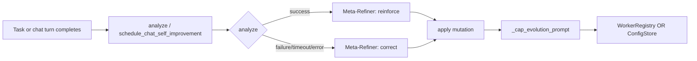

> The complete swarm system: the engine, six dispatch patterns, aggregation strategies, the reliability layer (circuit breakers, retries, timeouts, validators, concurrency), the worker registry, pipeline checkpoints, HITL bus (tri-state FanOut), and metrics. Invariants: [`AGENTS.md`](https://github.com/Mubder/kazma/blob/main/AGENTS.md) §4–§7, §9, §14, §30.

---

## 1. The SwarmEngine

`SwarmEngine` (`kazma-core/kazma_core/swarm/engine.py`) is the central async orchestrator. A backward-compatible `SwarmManager` façade wraps it (`manager.py`, sharing `self._workers = self.engine._workers`).

### 1.0 Platform bus (HITL / progress)

Outbound swarm progress + danger-tool approvals go through `SwarmMessageBus`
(`swarm/bus.py`). On Web boot (`app.py`):

- Every configured platform adapter (Telegram / Discord / Slack) is collected.
- **One** adapter → wired directly.
- **Two or more** → wrapped in `FanOutBusAdapter` so stream/report/alert fan
  out to all platforms, and an approval card is posted on each.
- None configured → `NullBusAdapter` (fail-closed for danger tools).
- Danger tools on this path go through `SafetyMiddleware.check()`. Which tools
  ask is the graph's own floor: `is_danger_tool()` is
  `safety.hitl.approval_floor()`, the tier rule `requires_approval()` uses, so
  an unclassified tool asks here too. Do not mint a second web gate from
  `LocalToolRegistry.execute` (H-8).

**One request, one decision** (`swarm/shared_approvals.py`):

- `check()` opens the request under a **freshly minted id**, bound to the tool
  and a hash of its arguments. The id never comes from the tool's arguments.
  A gate row in `hitl_gates.db` (mechanism `swarm_bus`) records it.
- Every platform's card shows the **whole call**: each argument's name and a
  bounded value, marked when cut, plus the arguments' hash
  (`swarm/approval_card.py`). Arguments that cannot be shown are refused.
- The decision is **one shared row** in the settings store
  (`swarm.approval.<id>`), decided once by compare-and-set. The first human
  decision on any platform decides it: an Approve, or a **Deny, which is
  final** (owner decision D7). Every card is then edited to that one outcome.
- The request's own deadline is the only one: past it the outcome is
  **`timeout`**, and a waiter that is cancelled ends it **`cancelled`**. Neither
  is a deny, in the gate registry or in the daily digest.
- A button press goes through `shared_approvals.decide_from_button(data,
  actor=…, platform=…)`. No adapter instance is needed, so a sender rebuilt
  since the card was posted does not lose the click. The gate row records
  **the human who pressed** (`telegram:<id>`, …), never `swarm_bus`.
- A decision that cannot be recorded (the settings store is down) is a WARNING
  naming the actor, and counts `kazma_swarm_failures_total{site="approval_resolve"}`;
  the request then stays pending until its deadline.
- **Every card links to the request on the Web dashboard** (`Full call:`, before
  the arguments block, so no platform's cut reaches it): the Swarm page's
  approval panel, `/swarm?approval=<id>`, on the install's `KAZMA_PUBLIC_URL`
  (the page's path when none is set). The panel shows the tool, its state and
  the whole call the gate record keeps, with the card's hash, and while the
  request waits it has **Approve** and **Deny**: one more place to give the same
  decision, recorded as `web` with the signed-in user (an operator's action;
  reading is open to any signed-in user). A swarm request is never on the
  dashboard's pending list, which admits a gate by the chat session it belongs
  to. Two identical calls asking at once are two requests, each with its own
  gate record.

**Which work asks at all** (`safety/call_authority.py`). The graph's interrupt()
decides the danger calls of a chat turn; for those calls the bus must not ask
again. That authority covers **one tool call** and is consumed by its first
execution: anything the call starts (a swarm task from `dispatch_swarm`, a
thread, another tool) finds it spent and asks the bus. Detached starters also
run in a context with no authority at all (`detached_context`).

### 1.0b Who may use the swarm

- **Roles** (`kazma_ui/swarm_panel/route_roles.py`). Every `/api/swarm/*` route
  is in `SWARM_ROUTE_ROLES`, enforced by the routers' `RoleCheckedRoute`:
  reading (GET) needs a signed-in user; anything that runs, changes or routes
  swarm work (dispatch, approve, reject, cancel, retry, workers and their
  system prompts, templates, the output target, breaker resets, start/stop)
  needs the admin decision. A route missing from the table is refused as
  admin-only, and `tests/test_swarm_route_roles.py` fails until it is listed.
- **A single-operator surface** (decision D1,
  `swarm/single_operator.py`). Swarm tasks are not separated per user, so on an
  install with platform users (or `KAZMA_MULTI_USER=1`) every swarm surface
  refuses: the Web API answers `409 swarm_single_operator`, the page says so in
  its language, and the chat `/swarm` command and the agent's `dispatch_swarm` /
  `check_swarm_task` reply with the reason. A settings store that cannot answer
  refuses too.
- **Routing a result to another chat** with the chat command's
  `-> platform:chat` suffix is admin-only, like `/swarm config`.

### 1.0c A task's run: one owner, one record

- **The engine owns the run** (`SwarmEngine._run_owned`). It registers the run
  before its first await, so cancel and the watchdog can stop it whoever
  started it. A second dispatch of a running id waits on that run; an id that
  already ended (or paused) is answered from its record and never run again.
  A caller that stops waiting stops the run, and waits (bounded) for it to end.
  Shutdown stops every run (`stop_all_runs`).
- **Admission is a compare-and-set on the RUNNING row** (`TaskStore.admit`).
  Each run has a `generation` and a `run_id`; the row moves only along the
  transition table (`persist_task`): a finished status is never left, a row is
  never sent back to `pending`, and a write from an older generation is
  refused. A refused late outcome is kept as evidence
  (`metadata.orphan_results`), never as the task's result.
- **An interrupted run says what it may have changed.** Every dispatch, step
  and task has an effect tracker (`agent/dispatch_effects.py`). A run stopped
  by the user, a deadline or shutdown ends with `interrupted_by` (its cause)
  and `execution_outcome`: `none_invoked`, or `unknown` with `invoked_tools`
  (the tools that change things it had run). A pattern's step timeout is built
  from the same tracker. A result whose effects are uncertain is stored
  `failed`, never completed.
- **Retry asks first when the outcome is unknown.** `POST
  /api/swarm/tasks/{id}/retry` answers `409 retry_outcome_unknown` (with the
  tools) for a task whose effects are unknown; the page asks the operator and
  sends `acknowledge_unknown=1`. A worker result marked `retryable: false`
  (a tool that changes things had run) stops the retry and the fallback chain.
- **A resumed pipeline skips the steps it already ran.** Each finished step is
  journaled on the task; a resume after a crash starts after the last one.
  Paused pipelines are restored at boot as paused in-flight tasks (they do not
  count against admission), so reject and cancel reach them.

### 1.0d What reaches a model is fenced

A worker's text is what it read and wrote (web pages, files, other tools'
output), so it reaches every model as **data** inside a
`fence_untrusted(...)` block, never as instructions: the agent's
`check_swarm_task` result and error, the previous worker's output and the
blackboard handed to the next pipeline step, a handoff's intermediate results,
the synthesis prompt (`aggregator._synthesize_by_model`) and the pipeline's
Refiner (`patterns._refiner_input`: each step under its worker's name).
`tests/test_swarm_boundaries_and_signals.py` fails on a swarm function that
builds text from a worker's output outside a fence, unless it is declared as
the task's stored result (which `check_swarm_task` fences where it reaches a
model).

### 1.0e Limits

| Limit | Value | Where |
|---|---|---|
| Task timeout (per step for patterns) | 1–3600 s | `swarm/limits.py` |
| Prompt / context / metadata | 64 KiB / 256 KiB / 64 KiB | same |
| Workers / checkpoints / fallback chain | 32 / 32 / 16 | same |
| Pipelines paused at once | 100 | same |
| Worker dispatches in parallel, all tasks | 64 | same |
| Task streams per client / in all | 16 / 128 | `kazma_ui/swarm_sse.py` |
| Stream heartbeat / lifetime | 15 s / 30 min (the client resumes) | same |

The Web API refuses an out-of-range request with `422`; the engine refuses one
from any other entry before admission. A full swarm answers `429
swarm_at_capacity` with `Retry-After`. A stored result keeps each large worker
output once, referenced from its other places.

### 1.0a Durable execution (Temporal, opt-in)

Swarm **planning** stays in-process. When `KAZMA_TEMPORAL_HOST` is set,
`SwarmEngine.dispatch` wraps `_dispatch_inner` in a Temporal workflow so a
crash can resume the step (`kazma_core/swarm/durable.py`). The Temporal
worker runs **inside the Kazma process** (app lifespan, fail-open). Default
is still asyncio. Kill-switch `KAZMA_TEMPORAL=0`. Strict:
`KAZMA_TEMPORAL_REQUIRED=1` (no in-process fallback). Extra:
`pip install -e ".[durable]"`.

### 1.1 Constructor

```python
def __init__(
    self,
    config: SwarmConfig | None = None,
    *,
    result_aggregator: ResultAggregator | None = None,
    task_store: TaskStore | None = None,
    metrics_collector: MetricsCollector | None = None,
    tracing_emitter: TracingEmitter | None = None,
) -> None: ...
```

### 1.2 Key attributes

| Attribute | Type | Purpose |
|---|---|---|
| `_workers` | `dict[str, SwarmWorker]` | Registered workers. |
| `_active_tasks` | `dict[str, SwarmTask]` | In-flight tasks. |
| `_task_handles` | `dict[str, asyncio.Task]` | Handles for cancel. |
| `_task_history` | `dict[str, SwarmTask]` | LRU-capped (`_max_history=500`). |
| `_routing_engine` | `UnifiedRouter` | Auto-routing for `workers=["auto"]`. |
| `_reliability` | `ReliabilityRegistry` | Breakers/retries/timeouts/validators/concurrency. |
| `_checkpoint_handler` | `HITLCheckpointHandler` | Paused-pipeline state. |
| `_checkpoint_mgr` | `CheckpointManager` | Checkpoint persistence + timeouts. |
| `_task_store` | `TaskStore` | SQLite persistence. |
| `_metrics_collector` | `MetricsCollector` | In-memory + SQLite metrics. |
| `_tracing_emitter` | `TracingEmitter` | In-house span emitter. |
| `_phonebook` | `WorkerPhonebook` | Topology/DAG worker lookup. |
| `_sse` | `SseBridge` | SSE event bridge. |

> Constructor signature is unchanged after the P2-1 split (`reliability_registry.py`, `phonebook.py`, `checkpoint_manager.py`). Test fixtures work without modification. Do not pin `engine.py` line counts — they drift.

---

## 2. The six dispatch patterns

`TaskType` enum (`swarm/task.py`): `DISPATCH`, `BROADCAST`, `PIPELINE`, `FAN_OUT`, `CONSULT`, `CONDITIONAL`. Routing lives in `dispatch_inner.py` (called from `engine.dispatch` → `engine._dispatch_inner`).

| Pattern | Engine entry | Implementing function | Description |
|---|---|---|---|
| **dispatch** | `engine.dispatch` → `dispatch_inner` | inline single-worker + optional fallback chain | One worker handles the task. |
| **broadcast** | `engine.dispatch` (`engine.broadcast` is a wrapper over it) | `broadcast.broadcast_task` | All workers receive the same prompt; admitted, recorded and finalized like any task. |
| **pipeline** | `dispatch_inner` | `patterns.execute_pipeline` | Ordered stages sharing a blackboard; supports HITL checkpoints. |
| **fan_out** | `dispatch_inner` | `patterns.execute_fan_out` | Parallel execution with bounded concurrency + aggregation. |
| **consult** | `dispatch_inner` | `consultation.execute_consult` | Parallel opinions + LLM synthesis. |
| **conditional** | `dispatch_inner` | `patterns.execute_conditional` | Router decides which route map entry to dispatch to. |

### 2.1 Auto-routing

`workers=["auto"]` is resolved in `dispatch_inner.py` via `engine._routing_engine.route(...)` (UnifiedRouter). Autoscaler `maybe_scale(...)` fires **only** on `NoCapableWorkersError` — never when a named worker is requested or routing succeeds.

**Semantic routing** (`swarm/semantic_router.py`, Swarm audit SW-E10). The task
and each worker's profile (its name -- an autoscaler instance's template --,
expertise and the start of its system prompt, else its role) are embedded by
Kazma's own embedder (`memory.embedder.get_embedder`, the model memory uses)
and compared by cosine, exactly, in the process: no vector store, so no store's
default embedding function. (The router used a Chroma collection that embedded
profiles with Chroma's 384-d default model while the task used bge-m3, 1,024-d:
every query failed on the dimensions.) A worker matches when its profile
**stands out**: its similarity minus the mean of the other distinct profiles'
(blended with 0.40 when fewer than three) is at least `MATCH_FLOOR` (0.045);
instances of one template share a profile. Measured with bge-m3 on
`tests/fixtures/swarm_routing/` (35 English and Arabic tasks, 7 workers;
`scripts/swarm_routing_bench.py`): 19 of 24 specialist tasks routed right (21
with the keyword fallback behind it; keywords alone 5, they read no Arabic),
1 of 11 unrelated tasks sent to a specialist, and a lone worker takes no task
about another (0 of 185). The nearest worker with no floor sent 7 of 11
unrelated tasks to a specialist and never let a task reach the autoscaler.

The embedding runs in a thread within `SEMANTIC_DEADLINE_S` (5 s), at most two
at once. With no embedder, a failing, slow or busy one, the task routes by
keywords; the routing diagnostics say why (`semantic.reason`), and the change
is logged once at WARNING (`kazma_swarm_failures_total{site="semantic_routing"}`),
its recovery at INFO.

**The task names the workers that ran.** A DISPATCH runs the best candidate,
so `task.workers` (and `metadata.routed_workers`) holds that one; every
candidate, with its similarity, evidence, keyword overlap and dialect boost, is
in `metadata.routing_diagnostics` (`candidates`, `scores`, `semantic`), written
before a refusal too. A task the autoscaler took records it there
(`autoscaled`: the template, the worker, whether it was reused).

### 2.2 Pipeline specifics

- **Shared blackboard** — each stage sees prior stages' outputs.
- **HITL checkpoints** — `task.metadata["hitl_checkpoints"]` is a set of 1-based step indices. At a checkpoint, execution pauses with `status="paused"` and checkpoint metadata.
- **Hand-on** — the next step gets the previous worker's output and the blackboard **fenced** (§1.0d).
- **Resume** — `patterns.resume_pipeline`, after the last journaled step (§1.0c).
- **Post-processing** (`patterns._finalize_pipeline`) runs four hooks: LLM "Refiner" synthesis, self-improvement, pipeline logger, then returns `PatternExecution`.
- **The Refiner** (Swarm audit SW-E15, decision D8: fixed). A pipeline that
  succeeded -- on its first run or a resume -- is distilled by one model call
  into a report. The report is the result's `synthesized_output` (the page's
  synthesis); the pipeline's product, its last step's output, stays
  `aggregated_output`, and every step's output stays in `worker_results`. Its
  tokens and cost are added to `total_tokens` / `total_cost`, kept in
  `metadata.refiner`, and recorded in the per-call LLM ledger with the task's id
  as `thread_id`, as a worker's calls are. It reads the steps' outputs fenced,
  4,000 characters in all, writes at most 2,048 tokens, and is given the step
  deadline (at most 120 s); the watchdog's budget for a pipeline counts it as
  one step more. A Refiner that fails, has no model or runs out of
  time leaves the unrefined result: a WARNING and
  `kazma_swarm_failures_total{site="refiner"}`, `metadata.refiner.status =
  "failed"`. A failed or partial pipeline is not refined (no report over a
  broken run). Before, its output never reached the stored result and, on
  failure, a "raw report" stood in for it.

### 2.3 Fan-out status mapping

| Condition | Status |
|---|---|
| all workers succeed | `success` |
| some succeed | `partial` |
| none succeed | `failed` |

---

## 3. Aggregation strategies

`ResultAggregator.aggregate` (`swarm/aggregator.py`), keyed by `task.aggregation` (default `"collect"`):

| Strategy | Behavior |
|---|---|
| `collect` | Metadata only; no aggregated output. |
| `first_valid` | First successful result. |
| `merge_all` | Join `[worker] output` blocks. |
| `vote` | Majority tally; ties broken by first-seen order. |
| `synthesize` | LLM synthesis via `_SYNTHESIS_SYSTEM_PROMPT`, each worker's output fenced; deterministic fallback `_fallback_synthesis`. |
| *(unknown)* | Raises `ValueError`. |

A synthesis (here and in a consult) is the task's to account, like the
Refiner's: its tokens and cost join the task's totals and `metadata.synthesis`,
and the ledger has the call. Every model call the swarm makes for a task
outside a worker goes through `swarm/task_model.call_task_model` (the agent's
`resilient_chat`: retries, failover, the ledger row); a fallback when the model
cannot answer is a WARNING and `kazma_swarm_failures_total{site="synthesis"}`.

---

## 4. Handoffs & cycle detection

When a worker hands off to another worker mid-task, `SwarmEngine._handle_handoff()` recurses. Infinite loops (A→B→A) are prevented by two guards in `swarm/handoff_guards.py`:

| Constant | Value | Meaning |
|---|---|---|
| `MAX_HANDOFF_DEPTH` | `5` | Max recursion depth. |
| `MAX_VISITS` | `2` | Max times a single worker may be revisited (allows legitimate A→B→A *return* handoffs). |

Mechanics:

1. `_visited` is a `dict[str, int]` of per-worker visit counts (not a boolean set).
2. `_register_handoff_visit` increments the source worker's count.
3. `_handoff_guard_error` trips on depth > 5 or per-worker visits > 2.
4. `_depth` is incremented inside `worker_dispatch.dispatch_worker` when it calls `engine._handle_handoff(..., _depth=_depth + 1)`.
5. On success/failure, the source breaker's `record_success`/`record_failure` is called **with the dispatch's admission** (§5.1).
6. The handing-off worker's intermediate results reach the target **fenced** (§1.0d).

> **Symbol naming note:** the engine docstring refers textually to `_MAX_VISITS`, but the exported symbol is `MAX_VISITS` (`handoff_guards.py`). Same value (2).

---

## 5. The reliability layer

`ReliabilityRegistry` (`swarm/reliability_registry.py`) is a **config holder**. The actual state machines live in `swarm/reliability.py`. Six components:

### 5.1 CircuitBreaker (`swarm/reliability.py`)

| Aspect | Detail |
|---|---|
| States | `CLOSED`, `OPEN`, `HALF_OPEN` (`CircuitState` StrEnum). |
| `failure_threshold` | default `5`. |
| `cooldown_seconds` | default `60.0`. |
| OPEN → HALF_OPEN | auto-transition when `time.monotonic() - _opened_at >= cooldown` (the `state` property). |
| **Admission** | `admit()` (`check_or_raise()` on the dispatch path) returns a `BreakerAdmission(generation, probe)`, or None when refused. In HALF_OPEN exactly ONE dispatch is let through, gated by `_probe_in_flight`. **Never remove this flag.** `allow_probe()` is `admit() is not None`. |
| **Generations** | every change of state (trip, close, reopen, reset) bumps `generation`. An outcome passed with an admission from an older generation, or any outcome but the probe's own while a probe is in flight, is **stale**: counted in `stale_outcomes`, never applied. A dispatch admitted before a trip cannot close a half-open breaker while the probe still runs. |
| `record_success(admission)` | resets `consecutive_failures`, clears the probe, HALF_OPEN → CLOSED. |
| `record_failure(admission)` | clears the probe; HALF_OPEN → re-OPEN with a fresh timer; CLOSED → increment, trip at threshold. |
| Shared state | with `KAZMA_SHARED_BREAKERS` on, `persist_shared` writes by compare-and-set on the settings store: a replica's write never replaces a newer generation. A reaped pool worker's keys are deleted (`forget_shared`). |
| Persistence | `to_dict()` / `from_dict()` (generation included); registry `save_breaker_state`/`load_breaker_state`. |

The breaker is read off the event loop (`ReliabilityRegistry.breaker_for_dispatch`, an RLock around every change).

### 5.2 RetryPolicy (`swarm/reliability.py`)

| Field | Default |
|---|---|
| `max_retries` | `3` |
| `base_delay` | `1.0` s |
| `max_delay` | `60.0` s |
| `jitter` | `True` |

Exponential backoff: `base_delay * 2**(attempt-1)`. One taxonomy with the LLM layer (`_is_retryable_exception`): an `LLMError` says itself (`transient`); otherwise 401/403, auth/unauthorized/forbidden, api key, not found, quota and billing are **permanent**, and a 429 / rate limit is **transient**. Retries on exceptions and on `status in ("error","timeout")` dicts, except a result marked `retryable: false` (a tool that changes things had run). A dispatch is **one** in-flight count however many attempts it makes.

### 5.3 TimeoutGuard (`swarm/reliability.py`)

| Field | Default |
|---|---|
| `default_timeout` | `300.0` s |
| `on_timeout` | `fail` \| `retry` \| `skip` |

Uses `asyncio.wait_for`. On timeout returns `\{"status": "timeout", ...\}` with optional `retry=True` / `skipped=True`.

### 5.4 OutputValidator (`swarm/reliability.py`)

Supports three schema kinds:

- **Pydantic `BaseModel`**
- **JSON Schema** (via `jsonschema` if installed, else built-in fallback)
- **Simple type dict** (`\{"name": "str"\}`)

Auto-parses string output as JSON when the schema expects an object/array.

### 5.5 FallbackChain (`swarm/reliability.py`)

Sequential fallbacks after primary failure. Each fallback gets a `HandoffRecord`. First success ends the chain; exhaustion returns a summary error.

### 5.6 BoundedConcurrency (`swarm/reliability.py`)

`asyncio.Semaphore` wrapper, default `max_concurrent=5`; async context manager that always releases on exit. Every task's limit sits under one process-wide cap of 64 parallel worker dispatches (`limits.MAX_PARALLEL_WORKERS`).

### 5.7 Per-worker configuration (via engine delegates)

| Method | Configures |
|---|---|
| `set_circuit_breaker_config(worker, failure_threshold, cooldown_seconds)` | Breaker thresholds. |
| `set_retry_policy(worker, policy)` | Retry policy. |
| `set_timeout_guard(worker, guard)` | Timeout. |
| `set_output_validator(worker, validator)` | Output schema. |
| `get_bounded_concurrency(task_max_concurrent)` | Concurrency (task override > engine default). |

---

## 6. TaskStore

`swarm/task_store.py` (`TaskStore`), default DB `<data dir>/swarm_tasks.db`; the Postgres table `kazma_swarm_tasks` when Postgres is configured.

### 6.1 Concurrency

PRAGMAs applied centrally via `apply_sqlite_pragmas()` from `config_store`:

```sql
PRAGMA journal_mode=WAL;
PRAGMA busy_timeout=5000;
PRAGMA synchronous=FULL;   -- the task store only: the RUNNING row is crash evidence
```

Single shared connection + `threading.Lock` (held by `close()` too). The engine
writes from threads, one task's writes in order (`SwarmEngine._persist`). On
Postgres every parameter goes through `_pg_execute` / `_pg_execute_one`, which
replace a NUL with U+FFFD, so both backends store the same text.

### 6.2 Schema

**`swarm_tasks`**: `id, type, prompt, status, workers (JSON), result, context, dependencies, fallback_chain, validation_schema, aggregation, timeout, created_at, started_at, completed_at, sort_at, cost, tokens, metadata, workspace_id, generation, run_id`. Indexes on `status`, `type`, `completed_at`, `created_at`, `sort_at`.

**`swarm_worker_metrics`**: `worker, date, tasks_completed, tasks_failed, avg_latency, total_tokens, total_cost`, PK `(worker, date)`.

### 6.3 Auto-migration

After `executescript(_SCHEMA)`, `kazma_core.db.sqlite_columns.add_missing_columns` adds whichever of the later columns are missing (AGENTS §6): it reads `PRAGMA table_info`, and a real failure raises. On Postgres the columns go through `db.pg_schema.ensure_schema`.

### 6.4 Worker filter (exact match)

`list_tasks()` filters by worker using `json_each()` — **not** `LIKE`:

```sql
WHERE EXISTS (SELECT 1 FROM json_each(workers) WHERE value = ?)
```

This avoids substring false-positives (e.g. worker `"a"` matching `"ab"`).
On Postgres the same filter is JSONB containment (`workers @> '["a"]'`);
`tests/test_task_store_backends.py` holds both backends to the same answers.

### 6.5 Retention (how long finished tasks are kept)

Settings → System → **Swarm task history**, stored as
`swarm.task_retention_days` (default **30**; **0** keeps every task; at most
3650). Every 15 minutes the maintenance sweep
(`memory.worker_bootstrap._MAINTENANCE_SWEEPS`) deletes completed, failed,
cancelled and timed-out tasks older than that. Paused, pending and running
tasks are never deleted. The worker-metric days older than the same cutoff go
with them. The value is read at each sweep, so a change applies
within 15 minutes, and `PUT /api/settings/single` refuses anything that is not
a whole number of days from 0 to 3650. Until 2026-09-25 the pruning routine
existed with nothing calling it, so history was never pruned.

---

## 7. Worker registry & phonebook

- **`WorkerRegistry`** (`swarm/registry.py`) — JSON-backed registry in the data dir (`<data dir>/swarm_registry.json`, so the backup copies it), loaded at singleton construction; an older build's file in the working directory is moved there once and renamed `.migrated`. Writes are atomic, and every change and read holds the registry's lock. Each `WorkerEntry` has: `name, expertise, roles, model, provider, worker_type, system_prompt, enabled, tools, metadata`.
- **`WorkerPhonebook`** (`swarm/phonebook.py`) — `summon(name)` builds an `InProcessWorker` from a WorkerRegistry entry (legacy TelegramWorker subprocess path removed); it runs nothing itself. `SwarmEngine.dispatch_by_name` registers a summoned worker the engine does not hold, adds the V2 `recall.search` hits (strategies + this worker's learnings, **prompt-fenced**, off the event loop: `phonebook.memory_context`) and dispatches through `dispatch()`, with admission, the RUNNING row and cancellation like any task.
- **`worker_factory._IN_PROCESS_TYPES`** = `\{"in_process", "telegram_bot"\}` — both resolve to `InProcessWorker`.

> **No predefined role/preset catalog.** Roles are free-form strings. The registry starts empty (nothing ships in it): it holds the workers added from the Swarm page or the API. A worker with an empty `system_prompt` counts as a generalist (`WorkerEntry.is_generalist`) whatever its expertise tags.

---

## 8. Pipeline checkpoints (HITL)

A pipeline can pause at configured steps for human approval.

| Component | Role |
|---|---|
| `HITLCheckpoint` / `HITLCheckpointHandler` | `swarm/checkpoint.py` — dataclass + pause/approve/reject coordination with `asyncio.Event`s. |
| `CheckpointManager` | `swarm/checkpoint_manager.py` — owns paused-pipeline state, auto-reject timeout, persistence through the engine's ordered writes. |

### 8.1 Flow

1. `SwarmEngine._handle_pipeline_checkpoint` delegates to `CheckpointManager.handle_pipeline_checkpoint`, which also `_gate_register_pipeline` (HITL Gate Registry — one row per pause).
2. The manager stores state, **arms an auto-reject timeout** if `task.metadata["checkpoint_timeout"] > 0`, sets task status to `PAUSED`, and persists to SQLite.
3. Approval: `SwarmEngine.approve_checkpoint` cancels the timeout, settles the registry row, sets `checkpoint.status="approved"`, pops the paused entry, and resumes from `next_step = checkpoint.step + 1` via `resume_pipeline(...)`.
4. Rejection: `SwarmEngine.reject_checkpoint` delegates to the handler and settles the gate.
5. **T-2:** a pipeline timeout must **finalize the task and `settle_gate`**. One without the other leaves a live card or an orphan row.
6. **Crash recovery:** `restore_paused_tasks()` reloads paused tasks as paused in-flight tasks and **re-arms timeouts**.
7. A gate row that cannot be registered or settled is a WARNING and counts `kazma_swarm_failures_total{site="gate_register"|"gate_settle"}`.

### 8.2 HTTP endpoints

- `POST /api/swarm/tasks/\{task_id\}/approve` (`swarm_panel/routes_tasks.py`) claims the checkpoint, records the resumed run RUNNING and answers **`202`** at once (`task_status: running`); the progress and the ending reach the page on the task stream. A checkpoint no longer pending is `409 not_pending`; a full swarm `429 swarm_at_capacity`.
- `POST /api/swarm/tasks/\{task_id\}/reject` answers `status: ok` with the task's own status beside it (`task_status`).

---

## 9. Metrics

`MetricsCollector` (`swarm/metrics.py`) — thread-safe in-memory accumulator backed by an optional `TaskStore`. Per-`(worker, date)` snapshots; each worker result is counted **once** (`_finalize_task`), an open-breaker refusal included:

| Metric | Meaning |
|---|---|
| `tasks_completed` | Successful tasks. |
| `tasks_failed` | Failed tasks. |
| `avg_latency` | Weighted running average. |
| `total_tokens` | Token sum. |
| `total_cost` | USD sum. |

Flushes to `TaskStore.record_worker_metric` on every record, in a thread. Exposed via REST at `GET /api/swarm/workers/\{name\}/metrics`.

Swarm bookkeeping that fails and loses evidence or a decision is a WARNING and
counts `kazma_swarm_failures_total{site}` on `GET /metrics`: `running_row` (the
RUNNING row), `task_write`, `orphan_evidence`, `recovery_read`, `reap`,
`idle_reap`, `gate_register`, `gate_settle`, `checkpoint_timeout_arm`,
`breaker_persist`, `approval_resolve`; and a degraded result: `refiner` (the
unrefined result kept), `synthesis` (the deterministic fallback),
`semantic_routing` (keywords route until the embedder is back, counted once).
A catch-all handler in the swarm or the
bus adapters that stays below WARNING must be declared with its reason
(`tests/test_swarm_boundaries_and_signals.py`).

Swarm worker metrics are this collector (in-memory + SQLite / Postgres upsert). The **app** still exposes Prometheus at `GET /metrics` (`kazma_ui/metrics.py`) for other counters (HITL gates, commitment, context trims). Do not conflate the two. See [Architecture → Observability](architecture#9-observability-current-state).

---

## 10. Tracing

`TracingEmitter` / `Span` / `InMemorySpanExporter` (in-house, `swarm/tracing.py`). **Not OpenTelemetry.** Spans are emitted for dispatch, handoff, and checkpoint events.

---

## 11. Self-improvement engine (feedback loop)

The self-improvement skill (`skills/self_improvement.py`) learns from outcomes **Kazma-wide**. There is **no** `SOUL.md` file and **no** live `agent_evolution.json` (that file is migrated once into ConfigStore and renamed `.migrated`).

| Surface | Hook | Where Soul is stored |
|---------|------|----------------------|
| **Chat** (Web SSE, Telegram/Discord/Slack gateway) | After each completed turn (skips HITL pauses) | ConfigStore key `self_improvement.agent_evolution` (`{"agents": {supervisor: {soul, history}}}`) |
| **Swarm** (pipeline / fan-out / conditional) | `_run_self_improvement` after pattern completion | `WorkerRegistry` `system_prompt` (capped `[SelfImprovement]` blocks) |

Kill-switch: `KAZMA_SELF_IMPROVEMENT=0` (checked live). Every injected delta is wrapped in `format_untrusted_block(source="self_improvement")` and rejected if `is_override_delta`. Soul confirm auto-ON in production / multi-user (`POST /api/commitment/soul/{cid}/confirm`).

### 11.1 The feedback loop



### 11.2 How it works (swarm)

1. **Hook fires** after every pipeline, fan-out, and conditional pattern completion (`patterns.py:_run_self_improvement`).
2. **Each worker is analyzed** against only its own result (not all stages).
3. The **Meta-Refiner LLM** generates a 2-3 sentence delta (reinforcement for success, correction for failure). WorkerResult `status=error` counts as failure.
4. The delta is **auto-applied** to the worker's system prompt via `_cap_evolution_prompt` (max 12 blocks, 8000 chars) unless the soul-confirm gate holds it.
5. On future dispatches, the updated worker Soul is used automatically.

### 11.2b How it works (chat)

1. After Web SSE `done` (not interrupted) or gateway graph completion, `schedule_chat_self_improvement` runs in the background.
2. Outcome: success unless empty/⚠️/error-looking reply.
3. Delta is capped and stored under agent id `supervisor` in ConfigStore.
4. Next turn: `agent_runner`, `sse_chat/`, and gateway `graph.py` inject the Soul block as a **fenced** system message (no graph rebuild required).

### 11.3 Status tracking

- `_mutation_log` records every applied delta (worker, delta, timestamp, status).
- `stats()` returns `\{"enabled": ..., "mutations_applied": N\}`.
- `mutation_history` returns the last 50 mutations.

---

## 12. Predefined pipelines (`kazma.yaml`)

| Pipeline | Stages |
|---|---|
| `standard` | `researcher` (worker `core`) → `refiner` (worker `bridge`) → `builder` (worker `core`) → `validator` (worker `bridge`). |
| `quick` | `researcher` (worker `core`) → `builder` (worker `core`). |

Each stage carries a `system_prompt`. See [Configuration → pipelines](configuration#pipelines).

---

## 13. CLI swarm commands

The full `kazma swarm` surface (dispatch, broadcast, consult, pipeline, fanout, history, metrics, approve, reject, circuit-breaker, …) is documented in [CLI Reference → swarm](cli-reference#6-kazma-swarm).

---

## 14. Dynamic autoscaler & worker templates

When a dispatched task has `workers=["auto"]` and no registered worker can
handle it (`NoCapableWorkersError`), the engine falls back to the **autoscaler**
(`swarm/autoscaler.py`) which **spawns a worker on demand** from a template —
so the swarm works with zero pre-registered workers.

- **Templates** live in `swarm_templates.json` (repo root). The shipped defaults
  are `coder` (max 3), `researcher` (max 2), `generalist` (max 5). A template
  matches a task by **word-boundary token matching** on its `capabilities.expertise`
  tags (the tag `coding` matches the prompt "write some python code" but not
  "decode this barcode"). Templates are ordered specialist → general
  (first-match-wins); the generalist is the catch-all.
- **Spawned instances** are named `<template>-pool-<boot tag>-<n>` (e.g.
  `coder-pool-3f9a-1`: the tag is new at every start, so a shared breaker of
  an earlier run's instance is never inherited), capped per-template by
  `max_instances`, and idle-reaped after 5 min (`AutoScaler.record_activity`
  refreshes the timer on each dispatch). An instance with a dispatch in flight
  (`SwarmWorker.in_flight`) is never reaped.
- **An idle instance takes the next task before a new one is spawned**
  (`AutoScaler._take`, for `maybe_scale` and `spawn_by_name`): one with no
  dispatch in flight and no task already handed to it. A handed-out instance
  is claimed until its dispatch begins (its in-flight count covers it from
  then) or its breaker refuses it, else for 60 s; a claimed instance is not
  reaped. An open breaker is not dodged: its instance is handed out and
  refuses, rather than a new instance being sent to the failing model. So a
  run of tasks the catch-all takes uses one instance, and tasks at the same
  time take one each, up to the bound. (Found by the SQ01 soak: the router
  matches instances by their template's words, so a task no template's words
  matched never reached an existing catch-all instance; each spawned a new
  one up to the bound, then failed for capacity until the idle ones were
  reaped.)
- **A template name dispatches too**: a task naming `coder` with no worker of
  that name gets an idle instance of the template, or a new one.
- **Best model for the task kind.** Template `model`/`provider` are left empty
  by default; the spawned worker then classifies its task
  (`models/router.py::classify_prompt` → `CODING`/`VISION`/`REASONING`/`GENERAL`)
  and picks the best **available** model via `models/selection.py`
  (`find_best_model_for_task`). Precedence: user task-default
  (`models.defaults.<kind>` from Settings → Models) → heuristic best-match by
  model-id patterns → active profile fallback. Env-lock (`KAZMA_MODEL`) always wins.
- **UI.** Manage templates in the Swarm panel → **Templates** tab
  (REST: `GET/POST/DELETE /api/swarm/templates`, `POST /api/swarm/autoscaler/reap`).
- **The autoscaler is template-driven, not LLM-per-task.** Keyword tokens + id
  heuristics get ~80% of the value at ~0 cost; the dormant `ModelRouter` graph
  hook (`model_router=None` in `agent_runner.py`) remains available for a future
  LLM-routing phase. Handoff cycle guards (§4) still apply to spawned instances.

---

## Documentation Audit Notes

- **`reliability_registry.py` is config-only.** The half-open `_probe_in_flight` logic and the generations live on the `CircuitBreaker` dataclass in `reliability.py`. Anyone modifying breaker semantics must edit `reliability.py`, not the registry.
- **No line numbers here.** This page names files and symbols; line numbers drifted (the approve and reject routes moved by about 90 lines) and are not kept.
- **Symbol `_MAX_VISITS` vs `MAX_VISITS`:** the engine docstring uses the underscored form, but the exported constant is `MAX_VISITS`. Same value (2).
- **The registry holds only the workers you add.** It ships empty; the production worker definitions are the templates in `swarm_templates.json`, from which the autoscaler spawns workers on demand.
- **Prometheus exists on the app** (`GET /metrics`). Swarm `MetricsCollector` is a separate SQLite snapshot — not a second Prom registry.
- **Soul is ConfigStore / WorkerRegistry**, never `agent_evolution.json` and never a markdown `SOUL.md`.
- Binding HITL rules: AGENTS.md §7 (one shared decision per bus request), §30 (registry), collision H-8/H-9/H-12/T-2.
- **Swarm audit 2026-10-13** (`docs/audits/AUDIT_SWARM_2026-10-13.md`, tracker `docs/plans/SWARM_INDUSTRIAL_HARDENING_GOAL.md`): the approval boundary, run ownership, effect evidence, the live page and stream, roles, fences and signals above are its Stages 1–5.
